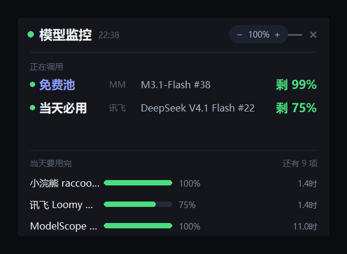
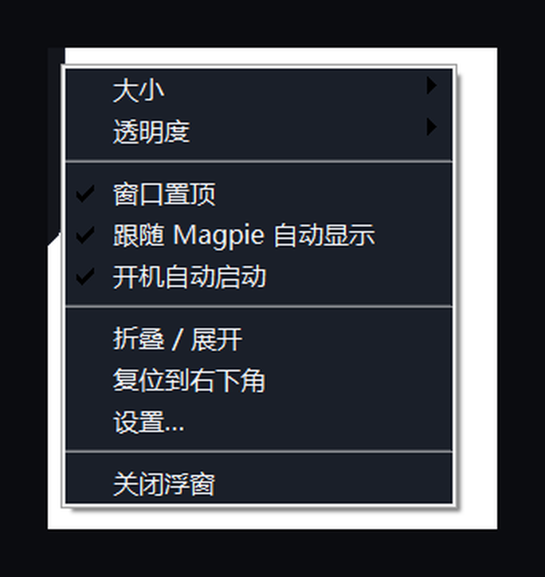

# Magpie Quota Widget · Magpie 额度浮窗

> 一块常驻桌面右下角的小面板：Magpie 现在在用哪个组的哪个模型、这个模型排第几、各家额度还剩多少、还有多久重置 —— 一眼看完。



Windows 10/11 · Python 3.10+（自带 tkinter 即可）· 纯标准库，零依赖 · 只读网关，不碰账号

---

## 它解决什么问题

用 Magpie 把一堆订阅/免费池聚成一个网关之后，最难回答的三个问题：

1. **这次请求到底用的是哪个模型？** 组是按顺序/智能路由的，你以为在用 A，其实早切到 B 了。
2. **这个模型什么水平？** 有强弱榜的话，名次直接标在模型名后面（`#38`）。
3. **还剩多少额度、什么时候回血？** 免费池最怕“用得正爽突然没了”，倒计时比百分比更重要。

浮窗把这些压进 356×252 的逻辑像素里，贴在屏幕角落，不抢焦点、不进任务栏。

## 功能

- **正在调用**：实时显示当前落点的组名、真实模型、剩余百分比、榜单名次
- **当天要用完**：按重置时间排的临期额度清单，谁快过期谁在上面
- **拖动记忆**：拖到哪记住哪，附带越界自愈（坐标漂出屏幕会自动回到右下角）
- **右键菜单**：大小 70%–130% / 透明度 100%–55% / 置顶 / 跟随 Magpie 自动显隐 / 隐藏付费额度 / 开机自启 / 折叠 / 复位
- **DPI 感知**：150% 缩放下按逻辑像素重排，不会字体挤压、文字截断
- **单实例 + 守护**：端口锁防重复启动；`widget_guard.py` 每 10 秒探活，崩了自动拉起
- **关掉不会自己回来**：点 × 会写 `widget_off.flag`，守护尊重你的选择；双击桌面「打开额度浮窗.cmd」恢复



## 安装

### 方式一：命令行（推荐）

```powershell
git clone https://github.com/qilijuan82065773-arch/magpie-quota-widget.git
cd magpie-quota-widget
powershell -ExecutionPolicy Bypass -File install.ps1
```

`install.ps1` 会：找 `pythonw.exe` → 校验 `tkinter` → 写开机自启 → 在桌面生成 `打开额度浮窗.cmd` → 立即启动守护。

### 方式二：丢给 Agent 装

把仓库链接发给 Claude Code / Codex / WorkBuddy 之类的 Agent，说一句：

> 按 SKILL.md 把这个 Magpie 额度浮窗装好

仓库根目录的 `SKILL.md` 就是给 Agent 看的：它包含环境检查、安装命令、验证方式和排障对照表。

### 手动跑（不装自启）

```powershell
pythonw quota_widget.py     # 直接开一个
pythonw widget_guard.py     # 守护模式：掉了自动拉回来
```

### 卸载

```powershell
powershell -ExecutionPolicy Bypass -File uninstall.ps1
```

停进程、删开机自启、删桌面快捷方式；源码和配置文件保留，想清干净直接删文件夹。

## 前置条件

- **Magpie 已在运行**，网关默认 `http://127.0.0.1:3425`
- **Python 3.10+**，且 `python -c "import tkinter"` 能过（python.org 安装包默认带；Microsoft Store 版可能缺）

## 配置

| 环境变量 | 默认 | 说明 |
|---|---|---|
| `MAGPIE_BASE` | `http://127.0.0.1:3425` | 网关地址，远程/容器可用 |
| `QUOTA_WIDGET_PORT` | `5599` | 单实例锁端口，一台机器开多个浮窗时改 |
| `PYTHONW` | 自动探测 | 指定 `pythonw.exe` |

界面偏好存在同目录 `widget_config.json`（缩放、透明度、位置、折叠、是否隐藏付费额度、是否开机自启），删掉即恢复默认。

**强弱榜名次是可选的**：把 `model_rank.json`（结构 `{"table":[{"model":"...","rank":1}]}`）放在同目录或上一级目录就会显示 `#名次`，没有也不影响其他功能。

## 它读哪些接口

```
GET /v1/magpie/quotas          各平台额度、重置时间
GET /v1/magpie/route           当前落点的组 / 模型
GET /v1/models                 组与模型清单
GET /v1/magpie/usage/requests  最近请求（判断"正在调用"）
```

全部只读，没有一行写网关的代码，不读也不存任何 token。

## 常见问题

**看不到浮窗？**
先看 `netstat -ano | findstr :5599`。有监听说明窗口在，多半是坐标漂到屏幕外或透明度太低 —— 删掉 `widget_config.json` 重开（v1.1 之后坐标越界会自动复位）。

**面板里一个组都没有？**
你还没在 Magpie 里建 routing group。`magpie groups` 看看，没有就先 `magpie group add`。

**额度全是 `—`？**
网关拿不到 quotas。`magpie accounts` 检查登录状态，或那个 provider 本身不暴露额度。

**和别的程序抢端口？**
`set QUOTA_WIDGET_PORT=5601` 后再启动。

**点了 × 之后再也不出现？**
设计如此。双击桌面「打开额度浮窗.cmd」，它会删掉关闭标记并重新拉起守护。

## 仓库结构

```
quota_widget.py     主程序（单文件，~1000 行）
widget_guard.py     守护进程
install.ps1         安装：自启 + 桌面快捷方式 + 立即启动
uninstall.ps1       卸载
SKILL.md            给 Agent 的安装说明书
screenshots/        真实截图
```

## License

MIT
